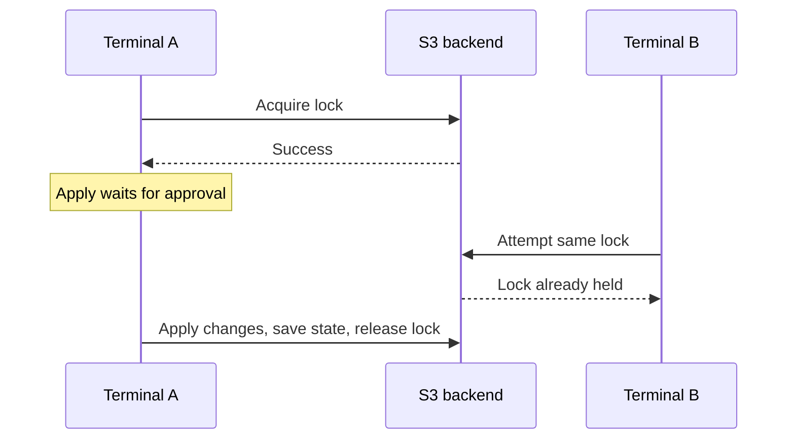

# Understand the project before typing commands

## Configuration, AWS and state

Your `.tf` files describe what you want. AWS contains the actual resources. Terraform state connects resource addresses in your code to AWS resource IDs.

```text
module.network.aws_vpc.main → an AWS VPC ID
```

During a normal plan, Terraform reads its record and asks AWS what exists, then compares that information with your configuration. A plan is a preview; an apply performs the changes. State is not a backup of the VPC itself. Restoring old state does not restore deleted infrastructure.

A state file can remain after destroy while tracking zero resources. `terraform state list` reads that inventory; an empty result alone does not prove every AWS resource is absent.

## Backend: where the state lives

A backend stores state and may support locking. The bootstrap root uses local state. The dev root uses an S3 object. Terraform still runs inside your container: remote storage does not move execution into AWS.

| Term | Plain explanation |
| --- | --- |
| Bucket | The S3 storage container |
| Key | The object's name inside the bucket |
| Region | AWS location holding the bucket |
| Versioning | Keeps earlier object versions for recovery |
| Encryption | Protects stored data; it does not replace access control |
| Public-access block | Helps prevent exposing the bucket or objects publicly |

State can contain sensitive information. Never commit it, a backup, or saved plans to Git. Access to state is privileged access.

The bucket must exist before Terraform can initialize an S3 backend. That is why bootstrap is a separate root. Its local state must be kept privately and backed up securely; a fresh clone cannot automatically manage the existing bootstrap bucket.

## Locking: one writer at a time

If two people read the same state and both change infrastructure, their assumptions can conflict. With locking enabled, the first operation obtains exclusive access; the second waits or fails to acquire it.



We use native S3 locking with `use_lockfile = true`. It creates a companion `.tflock` object. Older tutorials use DynamoDB; HashiCorp marks that mechanism deprecated. This is distinct from S3 Object Lock, which is an object-retention feature.

The scope of the lock is one state. Separate state keys can be managed independently. It does not block Console edits or operations that bypass locking. Do not use `-lock=false` to work around contention. Only consider force-unlock after confirming the original operation has stopped.

## Modules: reusable code with inputs and outputs

A module is a directory of Terraform files. The root module is where you run Terraform. A child module is called by the root.

```text
Dev root
  inputs: dev, CIDRs, availability zones, tags
             ↓
  modules/network
    creates VPC and subnets
             ↓
  outputs: VPC ID and subnet IDs
```

Files in one directory are read together. Naming a file `network.tf` does not make it a child module. A child module shares the calling root's state; it does not automatically have separate state.

| Expression | Meaning |
| --- | --- |
| `var.vpc_cidr` | An input supplied by the caller |
| `source = "../../modules/network"` | Local module path relative to the dev root |
| `for_each = var.subnets` | One subnet per named map entry |
| `each.key` | The entry name, such as private_a |
| `each.value.cidr_block` | That entry's address range |
| `merge(var.tags, {...})` | Combine maps; later values win for duplicate keys |
| `module.network.vpc_id` | Read a child module output |

A `/16` is a larger IPv4 address range than a `/24`. Both selected `/24` subnet ranges fit inside our VPC's `/16` and do not overlap each other. Availability zones are distinct locations within the region. A subnet name alone does not make it private: routing determines connectivity. Here there is no internet gateway or NAT route, and automatic public IPv4 assignment is disabled.

## Environments and tags

Dev is an independent root with its own state key. A future staging root could call the same child module with different values and a different key. Tags label resources; changing an Environment tag does not create state isolation.

Only dev is implemented. Separate directories and keys make boundaries visible, but do not provide IAM isolation by themselves. Production may use separate accounts and roles. CLI workspaces are another state-separation option; we chose explicit directories for clarity.

## Three different version controls

| File or setting | What it controls |
| --- | --- |
| `mise.toml` | Installed Terraform CLI version |
| `required_version` | Which CLI versions the configuration accepts |
| `required_providers` | Provider source and allowed version range |
| `.terraform.lock.hcl` | Selected provider versions and package checksums |
| S3 `.tflock` object | Temporary coordination of state access, not software versions |

`~> 6.0` accepts AWS provider versions at least 6.0 and below 7.0. Commit provider lock files for each root. They do not pin the CLI or local module code. The dev initialization selected AWS provider 6.72.0 in the captured output.

## Authentication has two consumers

The backend authenticates to read/write state and manage locks. The AWS provider authenticates to manage resources. Both use our existing `authentik-tf` profile, but configuring one does not automatically configure the other. `allowed_account_ids` catches the wrong account; it is not an IAM permission boundary.

## Official references

- [State purpose](https://developer.hashicorp.com/terraform/language/state/purpose)
- [S3 backend and locking](https://developer.hashicorp.com/terraform/language/backend/s3)
- [State locking](https://developer.hashicorp.com/terraform/language/state/locking)
- [Modules](https://developer.hashicorp.com/terraform/language/modules)
- [Dependency lock file](https://developer.hashicorp.com/terraform/language/files/dependency-lock)
- [Workspaces](https://developer.hashicorp.com/terraform/language/state/workspaces)
- [S3 pricing](https://aws.amazon.com/s3/pricing/)
