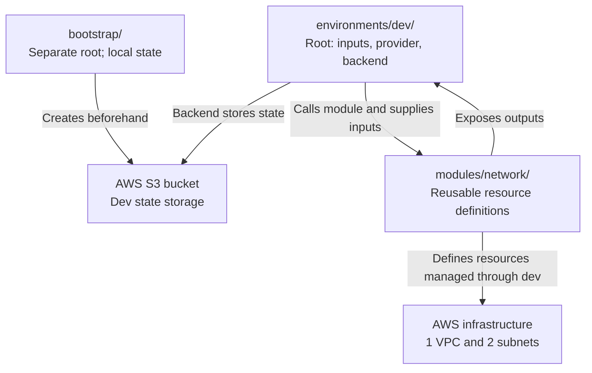

# Terraform Project 02 — Explained as a Conversation Between Folders

Imagine your Terraform project is a small company. Every folder is a different employee with a particular job.

Instead of reading Terraform only as code, follow a conversation between these employees. By the end, you will understand who talks to whom, what information they exchange, and why the same filenames appear in different folders.

This is **lab 02, master catalog project #16: Terraform remote state, modules and locks**. The code snippets here focus on individual ideas; they are not replacements for the complete, secured configuration in the [build guide](https://github.com/nazmur96/codex-k8s-projects/blob/main/docs/02-terraform-state/02-build.md).

## Meet the three employees

| Folder | Employee | What they say |
| --- | --- | --- |
| `bootstrap/` | Storage Manager | “My job is to create an S3 bucket so Terraform has a safe place to remember what it manages.” |
| `environments/dev/` | Project Manager | “I decide what infrastructure we need, give specifications to the builder, and configure where Terraform stores the state.” |
| `modules/network/` | Network Engineer | “Give me the network specifications, and I will define your VPC and subnets. I will expose their IDs as outputs.” |

Terraform reads the configuration, plans the work, and uses the AWS provider to make approved AWS changes. The employees are an analogy: folders do not literally run programs or talk to AWS themselves.

## Chapter 1 — Bootstrap prepares the storage

You open `bootstrap/` and run Terraform.

**Terraform:** “Bootstrap, what do you want me to do?”

**Bootstrap/main.tf:** “Before we build our network, we need somewhere to save its Terraform state. Please create an S3 bucket in AWS.”

```hcl
resource "aws_s3_bucket" "state" {
  bucket = "nazmur96-tfstate-750702271569-euc1"
}
```

**Terraform:** “Which AWS account and region should I use?”

**Bootstrap/providers.tf:** “Use our configured AWS account and the Frankfurt region, `eu-central-1`.”

**Bootstrap/versions.tf:** “And use compatible Terraform and AWS provider versions.”

After a plan is reviewed and apply is approved, Terraform contacts AWS through the provider and creates the bucket and its configured protections.

**AWS:** “Your bucket has been created.”

**Bootstrap/outputs.tf:** “Great! I will expose the bucket name so Terraform can show it to the person running the command.”

### Where does bootstrap store its own state?

**Bootstrap:** “I am creating the S3 bucket. I cannot initialize a backend in a bucket that does not exist yet! In this lab, I will keep my own state locally.”

That is why bootstrap runs independently.

```text
bootstrap/ ──creates──> AWS S3 bucket
    │
    └── its own state remains local
```

Keep bootstrap's state private and preserve it. Its local state still manages the bucket even after dev starts using S3.

## Chapter 2 — Dev discovers the S3 bucket

The bucket now exists. You switch to `environments/dev/` and run `terraform init`.

**Terraform:** “Hello dev! Where should I store your state?”

**Dev/backend.tf:** “Bootstrap already created a bucket for us. Use it and save my state at `project-16/dev/terraform.tfstate`.”

```hcl
terraform {
  backend "s3" {
    bucket       = "nazmur96-tfstate-750702271569-euc1"
    key          = "project-16/dev/terraform.tfstate"
    region       = "eu-central-1"
    use_lockfile = true
    encrypt      = true
  }
}
```

This shortened example leaves out the authentication and account checks shown in the full lab files.

**Terraform:** “I will connect to that bucket and use it as this environment's backend.”

```text
bootstrap/main.tf ──creates──> S3 bucket <──uses── dev/backend.tf
```

Dev refers to the existing bucket by name. **It does not call bootstrap as a Terraform module.** These roots are connected through the AWS bucket, not through a direct module relationship. Dev's initialization does not run bootstrap or create a missing bucket.

## Chapter 3 — Dev hires the network engineer

You open `environments/dev/main.tf`.

**Dev:** “My state storage is ready. Now I need AWS networking. I will use the reusable network module rather than duplicate its resource definitions.”

```hcl
module "network" {
  source = "../../modules/network"

  environment = "dev"
  vpc_cidr    = "10.30.0.0/16"

  # Subnets and tags are also passed here in the complete configuration.
}
```

**Terraform:** “I see a module call named `network`. I will follow its source path to find that directory.”

`../../modules/network` is relative to the dev root: go up from `dev` to `environments`, up again to the lab directory, then into `modules/network`.

**Network module:** “What kind of network would you like?”

**Dev:** “A VPC with CIDR `10.30.0.0/16`, two subnets in different availability zones, and the environment name `dev`.”

**Network module:** “Send those values as inputs, and I will use them in my resource definitions.”

That is the purpose of the module block: select the child module and provide its input values. The name `network` in `module "network"` is the name used when referencing this particular module call.

## Chapter 4 — The network module receives the instructions

Inside `modules/network/`, three files help organize the conversation:

- `variables.tf` defines the accepted inputs.
- `main.tf` uses those inputs to define resources.
- `outputs.tf` exposes results to the caller.

### First: variables.tf defines the input

**Network/variables.tf:** “I accept a VPC CIDR, and it must be a string.”

```hcl
variable "vpc_cidr" {
  type = string
}
```

**Dev/main.tf:** “Here is your value: `10.30.0.0/16`.”

**Network module:** “I can refer to that supplied value as `var.vpc_cidr`.”

The variable declaration does not create an AWS resource. It defines the module's input contract.

### Second: main.tf uses the value

**Network/main.tf:** “Terraform, define a VPC using the CIDR I received.”

```hcl
resource "aws_vpc" "main" {
  cidr_block = var.vpc_cidr
}
```

**Terraform:** “The value of `var.vpc_cidr` is `10.30.0.0/16`, so that is the address range I will use in the AWS request during apply.”

**AWS:** “VPC created. Here is its ID.”

```text
DEV/MAIN.TF — SUPPLIES THE VALUE
vpc_cidr = "10.30.0.0/16"
                 │
                 ▼
NETWORK/VARIABLES.TF — DEFINES THE INPUT
variable "vpc_cidr" { type = string }
                 │
                 ▼
NETWORK/MAIN.TF — USES THE INPUT
cidr_block = var.vpc_cidr
                 │
                 ▼
AWS VPC: 10.30.0.0/16
```

**Terraform does not execute `variables.tf` before `main.tf`.** It reads the `.tf` files in the directory together. The arrows show how values are connected, not a filename execution order. Dependencies determine which resource operations must wait for others.

## Chapter 5 — Dev asks for two subnets

**Dev:** “I also need two subnets inside the VPC, one in each of two availability zones.”

Inside the module call, dev supplies:

```hcl
subnets = {
  private_a = {
    cidr_block        = "10.30.10.0/24"
    availability_zone = "eu-central-1a"
  }

  private_b = {
    cidr_block        = "10.30.11.0/24"
    availability_zone = "eu-central-1b"
  }
}
```

**Network/variables.tf:** “I accept that map of subnet specifications.”

**Network/main.tf:** “I will use `for_each` to define one subnet for each entry.”

```hcl
resource "aws_subnet" "main" {
  for_each = var.subnets

  vpc_id            = aws_vpc.main.id
  cidr_block        = each.value.cidr_block
  availability_zone = each.value.availability_zone
}
```

**Terraform:** “The `private_a` entry defines one subnet with CIDR `10.30.10.0/24`. The `private_b` entry defines another with CIDR `10.30.11.0/24`.”

“Both refer to `aws_vpc.main.id`, so I know which VPC they belong to. That reference also tells me the VPC must exist before I create these subnets.”

**AWS:** “The VPC and both subnets are created.”

```text
VPC: 10.30.0.0/16
├── private_a: 10.30.10.0/24, eu-central-1a
└── private_b: 10.30.11.0/24, eu-central-1b
```

| Expression | Read it as |
| --- | --- |
| `each.key` | “The name of this entry, such as private_a.” |
| `each.value.cidr_block` | “The CIDR inside this entry.” |
| `each.value.availability_zone` | “The zone inside this entry.” |

`for_each` defines distinct resource instances; it does not require them to be created sequentially. Once their VPC is ready, independent subnet operations can run in parallel.

The complete configuration disables automatic public IP assignment. There is no internet gateway or NAT route. Calling a subnet “private” does not by itself determine connectivity; routing and other settings do.

## Chapter 6 — The network engineer reports back

**Network module:** “I have resource IDs available. Would you like me to expose them?”

**Dev:** “Yes. Those could be useful if a future project needs to use this network.”

**Network/outputs.tf:** “I will expose the VPC ID to my caller.”

```hcl
output "vpc_id" {
  value = aws_vpc.main.id
}
```

**Dev/outputs.tf:** “I will read that child-module output and expose it as a root output.”

```hcl
output "vpc_id" {
  value = module.network.vpc_id
}
```

**Terraform:** “Now `terraform output` in the dev root can display that value after it is recorded in state.”

| Reference | Meaning |
| --- | --- |
| `aws_vpc.main.id` | “The ID attribute of the VPC resource in this module.” |
| `module.network.vpc_id` | “The vpc_id output exposed by the module call named network.” |

```text
AWS VPC ID
    ↓
network/outputs.tf exposes aws_vpc.main.id
    ↓
dev/outputs.tf reads module.network.vpc_id
    ↓
terraform output displays the root output
```

Outputs do not have to wait until every other resource finishes; Terraform evaluates values when their dependencies are available. The story describes the relationship rather than a strict sequence of file execution.

## Chapter 7 — Dev saves the resource record to S3

**Terraform:** “How will I remember what I manage when you run me tomorrow?”

**Dev/backend.tf:** “Use the bucket bootstrap created.”

**Terraform:** “I will record resource identities and other management information under `project-16/dev/terraform.tfstate`.”

**Network module:** “Do I need my own bucket or separate state?”

**Dev:** “No. Your resources are part of this root module's deployment. They are recorded in my state.”

The network module is reusable code. **The dev root owns the state for resources created through this module call.** Bootstrap owns a separate local state for the backend bucket.

Example state addresses are:

```text
module.network.aws_vpc.main
module.network.aws_subnet.main["private_a"]
module.network.aws_subnet.main["private_b"]
```

Terraform can save state during an apply, including when only some operations succeeded. State persistence is not simply a final step that happens only after perfect success. Preserve state after errors so you can inspect partial resources and plan recovery.

## Chapter 8 — Two engineers try to change the infrastructure

**Engineer A:** “I am running apply against dev.”

**Terraform using the S3 backend:** “I will acquire the lock for this state before proceeding.”

**Engineer B:** “I am also running apply against the same state.”

**Terraform using the S3 backend:** “Another operation holds the lock. I must wait or fail rather than proceed concurrently.”

That is why the backend has:

```hcl
use_lockfile = true
```

After A finishes and releases the lock, another operation can acquire it. This coordinates Terraform access to one state; it does not prevent manual Console changes or protect an operation that deliberately bypasses locking.

In our actual drill, A waited at the apply approval prompt. B used `-lock-timeout=5s` and received `Error acquiring the state lock` with S3 `412 PreconditionFailed`. A then completed normally. See the [captured proof and replay instructions](https://github.com/nazmur96/codex-k8s-projects/blob/main/docs/02-terraform-state/03-proof-and-cleanup.md).

## Chapter 9 — Replay the project from beginning to end

These are the conceptual stages. Use the complete build guide for runnable commands, authentication, plan review and approval. Do not reapply an existing deployment blindly.

1. **Run bootstrap first.** “AWS, create the state bucket and its protections.” Bootstrap records its own resources locally.
2. **Initialize dev.** “Connect to the existing S3 bucket, prepare the local network module, and install the required provider.” Init creates no VPC or subnets.
3. **Plan dev.** “Here is the network module and its input values. Show the changes needed.” Variables define accepted inputs; resources use their values.
4. **Apply after review and approval.** Terraform acquires the state lock and uses the provider to perform the planned AWS changes.
5. **Expose results.** Child outputs make values available to the root; root outputs make selected values available through `terraform output`.
6. **Persist state and release the lock.** Terraform records the deployment in S3 and releases the operation's lock normally.

Remote state means remote **storage** here. The Terraform process still runs inside your devcontainer.

## Chapter 10 — Why do different folders have the same filenames?

Each folder is a separate team with its own documents. `bootstrap/main.tf` is not linked to `dev/main.tf` simply because both are called `main.tf`.

| Conventional filename | What it would say |
| --- | --- |
| `main.tf` | “Here are my resource definitions or module calls.” |
| `variables.tf` | “Here are the inputs I accept.” |
| `outputs.tf` | “Here are the values I expose.” |
| `providers.tf` | “Here is how to configure communication with AWS.” |
| `versions.tf` | “Here are the CLI/provider requirements.” |
| `backend.tf` | “Here is where this root stores state.” |

These filenames organize the code. They are not execution stages. Terraform combines ordinary `.tf` files in each module directory into one configuration; it does not automatically combine nested directories. The module call is what connects dev to the child module.

The child declares its AWS provider requirement but inherits the configured AWS provider from dev in this lab. Backend authentication and provider authentication are separately configured, even though both use our existing profile.

### The four connections worth memorizing

| Terraform syntax | Read it like a conversation |
| --- | --- |
| `source = "../../modules/network"` | “Find and use that network module.” |
| `vpc_cidr = "10.30.0.0/16"` | “Here is the input value I am giving you.” |
| `var.vpc_cidr` | “Use the input value this module received.” |
| `module.network.vpc_id` | “Read the output exposed by that module call.” |

## The entire project in one picture



The arrows show two different relationships: dev **uses an existing bucket** for state and **calls a child module** to define infrastructure. Bootstrap is a separate root that creates the bucket beforehand.

If you remember one conversation, remember this:

**Dev:** “Network module, here is what I want you to build.”

**Network:** “Give me your requirements through my input variables.”

**Dev:** “Here are the values.”

**Network:** “I will define the VPC and subnets using those values.”

**AWS, during approved apply:** “The resources are created. Here are their IDs.”

**Network:** “Dev, here are the values I expose as outputs.”

**Dev:** “Terraform, keep the deployment's management record in my S3 backend.”

The surrounding files organize those relationships, configure AWS access, declare version requirements, and protect state. For actual evidence and the still-pending cleanup, return to the [lab index](https://github.com/nazmur96/codex-k8s-projects/blob/main/docs/02-terraform-state/README.md).
